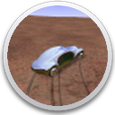
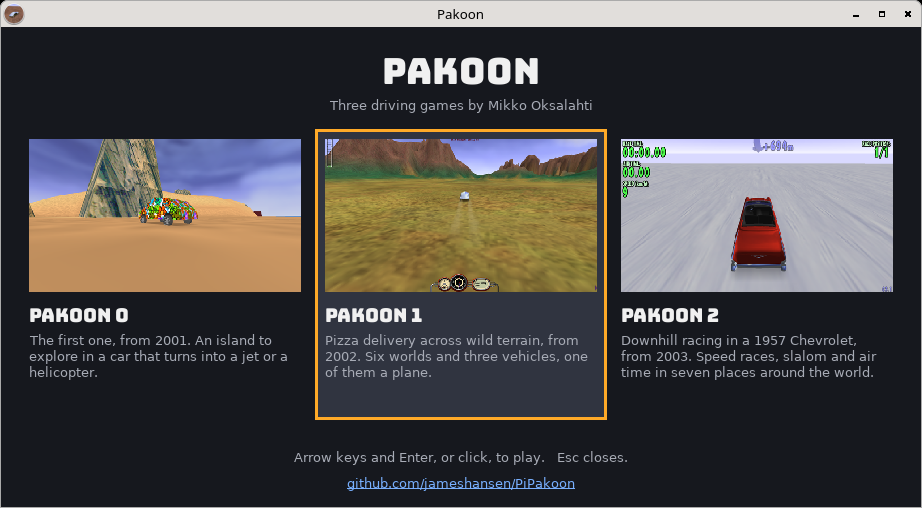
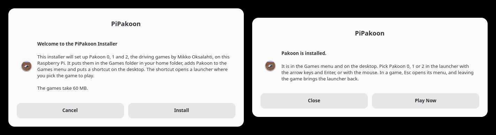

<p align="center"></p>

<h1 align="center">PiPakoon</h1>

<p align="center"><b>Pakoon 0, 1 and 2 on the Raspberry Pi.</b><br>A friendly installer that sets up Mikko Oksalahti's three driving games on a Pi 4, 400, 5 or 500, with one launcher to pick between them. There is a build for Windows too.</p>

<p align="center"><a href="../../releases/latest"><b>Download for Raspberry Pi OS or Windows</b></a></p>

<p align="center">Discord: <a href="https://discord.gg/88VzuWSYUc">https://discord.gg/88VzuWSYUc</a></p>



## What it does

Pakoon is a series of free driving games by Mikko Oksalahti. PiPakoon installs all three on a Raspberry Pi, built for the Pi from their source code, and puts one Pakoon entry in the Games menu and on the desktop. That entry opens a launcher where you pick the game to play.

| Game | What you do |
| --- | --- |
| **Pakoon 0** (0.03a, 2001) | Explore an island in a car that turns into a jet or a helicopter. |
| **Pakoon 1** (1.ONE, 2002) | Deliver pizza across wild terrain. Six worlds and three vehicles, one of them a plane. |
| **Pakoon 2** (2.MANY, 2003) | Race downhill in a 1957 Chevrolet. Speed races, slalom and air time in seven places around the world. |

The whole install is about 50 MB in one folder in your home folder.

## The original games

Pakoon is the work of Mikko Oksalahti, who released the complete source code of all three games in 2004 under the GNU General Public License. The games were written for Windows. A GitHub user, tunp, ported each of them to SDL so they build on Linux, as [Pakoon0](https://github.com/tunp/Pakoon0), [Pakoon1](https://github.com/tunp/Pakoon1) and [Pakoon2](https://github.com/tunp/Pakoon2). PiPakoon starts from those ports. The changes it makes are small and are listed in [`src/CHANGES.md`](src/CHANGES.md).

PiPakoon is an unofficial installer and is not affiliated with Mikko Oksalahti or tunp.

## Features

- **A proper installer.** A welcome screen, a progress bar and a finished screen, built from the dialogs Raspberry Pi OS already has. No terminal needed.
- **Nothing else to download.** The games come with the installer, already built for the Pi.
- **One launcher for three games.** Pick with the arrow keys and Enter, or with the mouse. Leaving a game brings the launcher back.
- **Native.** The games are compiled for the Pi's own processor and draw with its graphics chip. There is no emulator in between.
- **Tuned for each Pi.** On a Pi 4 or 400, Pakoon 1 and 2 draw 720 lines and the display scales the picture up to fill the screen. That takes Pakoon 1 from about 20 frames a second to 45 or more. A Pi 5 or 500 draws all 1080.
- **Self-contained.** Everything lives in `Games/Pakoon`. Nothing is installed system-wide and no packages are added.
- **Reinstall or remove.** Run the installer again. Reinstalling keeps your settings, scores and progress.
- **On Windows too.** The same games and launcher, built for 64-bit Windows, in one folder that needs no installing.



## Install

1. Download `PiPakoon.tar.gz` from the [latest release](../../releases/latest) and extract it. In the file manager, right-click the file and choose Extract Here.
2. Open the `PiPakoon` folder, double-click `install.sh` and choose Execute.
3. Choose **Install**, then **Play Now**.

From a terminal the same thing is:

```bash
tar -xzf PiPakoon.tar.gz && PiPakoon/install.sh
```

| Raspberry Pi | Notes |
| --- | --- |
| Pi 4 and Pi 400 | Pakoon 1 and 2 draw 720 lines, scaled up to fill the screen. |
| Pi 5 and Pi 500 | Pakoon 1 and 2 draw the full 1080 lines. |

It needs 64-bit Raspberry Pi OS 13 (trixie) or newer with the desktop, and 100 MB of free space.

### Windows

Download `Pakoon-Windows.zip` from the [latest release](../../releases/latest), extract it anywhere and run `Pakoon.exe` in the `Pakoon` folder. It needs 64-bit Windows. Nothing is installed; to remove it, delete the folder.

## Playing

Start Pakoon from the Games menu or the desktop and pick a game in the launcher. Each game fills the screen. Esc opens a game's menu, and leaving the game brings the launcher back. Esc in the launcher closes it.

All three drive the same way.

| Key | Action |
| --- | --- |
| Arrow keys | Steer, accelerate and reverse |
| Left Ctrl | Brake |
| Esc | Menu |

Each game adds its own.

| Game | Key | Action |
| --- | --- | --- |
| Pakoon 0 | J and H | Turn the car into a jet or a helicopter |
| Pakoon 0 | F1 to F5 | Camera views |
| Pakoon 0 | Home | Back to the start |
| Pakoon 1 | F1 | Help |
| Pakoon 1 | F2 to F5 | Camera views |
| Pakoon 1 | F8 | Map |
| Pakoon 1 | Enter and Left Shift | The plane's propeller, forward and reverse |

Pakoon 0's menus are worked with the mouse. Pakoon 1 and 2 use the arrow keys and Enter.

Settings, scores and progress are kept in each game's folder inside `Games/Pakoon`.

To draw a different number of lines on a Pi, start the launcher with `PAKOON_HEIGHT` set. Fewer lines run faster and look softer.

```bash
PAKOON_HEIGHT=540 ~/Games/Pakoon/pakoon
```

To play in a window, on a Pi or on Windows, set `PAKOON_WINDOW` to its size.

```bash
PAKOON_WINDOW=1280x720 ~/Games/Pakoon/pakoon
```

## How it works

The three games are C++ programs that draw with OpenGL and use SDL2 for the window, the keyboard and the sound. `tools/build-runtime.sh` compiles them on a Pi and packs them, with the files they play from, into `runtime.tar.xz`. Everything they load at run time is part of Raspberry Pi OS with desktop, apart from SDL2_net, which Pakoon 2 uses for its multiplayer mode and which travels in `lib/` beside the games.

A Pi 4's graphics chip is the limit, not its processor. At 1080 lines Pakoon 1 ran at 14 to 22 frames a second on a Pi 400 with the processor mostly idle. The games now open their window through SDL's Wayland driver, which can give a full-screen program a smaller picture and have the display scale it up. `PAKOON_HEIGHT` names the lines to draw, and the launcher script sets it for the Pi it runs on. At 720 lines a Pi 400 runs Pakoon 1 at 45 to 60 frames a second and Pakoon 2 at about 60. Where the Wayland driver is not in use, the games draw at the display's own size.

The sound mixer is fixed. A short looping sound played at a high pitch, the engine at speed, was read past its end, which crashed the game now and then.

The games are held to 100 frames a second. They do a whole number of physics steps per frame, 200 or 300 a second divided by the frame rate, so on a PC that drew 500 frames a second the count came to nothing and Pakoon 1's car stood still.

The launcher is a small SDL program, `src/launcher/launcher.cpp`. On a Pi it shows the three games, prints the number of the one picked and ends, and the `pakoon` script starts that game and opens the launcher again afterwards. On Windows the launcher starts the game itself and waits for it. The launcher and the games all name their window `pakoon`, which is how the Pi's taskbar finds the menu entry and shows its icon for each of them.

## Building the runtime

This is only needed after changing the source. On a Raspberry Pi with an internet connection:

```bash
tools/build-runtime.sh
```

It takes about three minutes on a Pi 400 and needs only `g++` and `make`, which Raspberry Pi OS comes with. The headers the Pi lacks are downloaded as Debian packages and unpacked into the build folder in the Pi's memory disk, so nothing is installed. The script ends by printing the number of entries in `runtime.tar.xz`; put that number in `RUNTIME_FILES` in `install.sh`, where the progress bar uses it.

### Building for Windows

```bash
tools/build-windows.sh
```

This runs on Windows in Git Bash, or on Linux, and needs [zig](https://ziglang.org) as the compiler, with `curl`, `tar` and `python3`. It downloads SDL2's Windows libraries and the Ogg and Vorbis sources, checks them against known sums, compiles everything and writes `dist/Pakoon-Windows.zip`.

### A release

A release has two files. The Pi's is the installer, the runtime, the icon and the licence in one archive, and the Windows zip comes from the script above.

```bash
git archive --format=tar.gz --prefix=PiPakoon/ -o PiPakoon.tar.gz HEAD install.sh runtime.tar.xz icon.png LICENSE
```

## Pi Projects

PiPakoon is one of five projects for the Raspberry Pi. One is a utility for the desktop, and four bring favourite old games to the Pi with the same kind of installer.

| Project | What it is |
| --- | --- |
| [PiOSBeachBall](https://github.com/jameshansen/PiOSBeachBall) | A spinning beachball pointer that shows when an app is loading. |
| [PiKnytt](https://github.com/jameshansen/PiKnytt) | Knytt, the 2006 exploration platformer by Nifflas, installed and ready to play. |
| [PiKlassOf99](https://github.com/jameshansen/PiKlassOf99) | Klass of 99, Richard Jordan's Skool Daze remake, installed and ready to play. |
| **PiPakoon** | Pakoon 0, 1 and 2, Mikko Oksalahti's driving games, built for the Pi with a launcher to pick between them. |
| [PiArcBoot](https://github.com/jameshansen/PiArcBoot) | Acorn Archimedes games from JASPP, installed and booted straight into the game. |

## AI use disclosure

PiPakoon was built using [Claude Code](https://claude.com/claude-code) with Claude Fable 5.2.

## Credits

Pakoon 0, 1 and 2 were made by Mikko Oksalahti. The full credits are in each game's menu. The SDL ports that PiPakoon builds on are by tunp. The icon shows the Bogian, a car from Pakoon 1, in the desert.

The games use [SDL2](https://www.libsdl.org) with SDL2_image, SDL2_ttf and SDL2_net, and [Ogg Vorbis](https://xiph.org/vorbis/). The copy of SDL2_net in `runtime.tar.xz` is Debian's build of version 2.2.0, under the zlib licence. The Windows zip carries the SDL project's own builds of the four libraries, and each one's licence is in its `licences` folder.

The launcher's title and game names are set in [Bungee](https://github.com/djrrb/Bungee) by David Jonathan Ross, under the SIL Open Font License in `fonts/OFL.txt`.

## Licence

The games are free software under the GNU General Public License, version 2 or later. That covers `src/pakoon0`, `src/pakoon1` and `src/pakoon2`, each of which keeps its `Copyright.txt` and `gpl.txt`, the changes made to them here, and the programs built from them in `runtime.tar.xz`. They are Copyright (C) 2004 Mikko Oksalahti.

The installer, the launcher and the build scripts are free software under the [MIT licence](LICENSE). The launcher's font is under the SIL Open Font License in `fonts/OFL.txt`.
